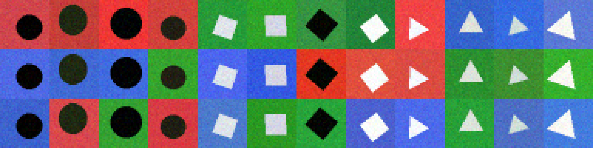

# LatentLens

An interactive lab for studying **shortcut learning** and **distribution shift** in a small CNN, with real PyTorch
experiments, a Streamlit interface, and an NVIDIA Nemotron research assistant served through Nebius Token Factory.

**Research question:** *Can targeted training interventions reduce shortcut learning and improve a CNN's generalization when
background–label correlations change?*

License: **MIT** (see `LICENSE`).


*Rows: correlated backgrounds (90 % class-matched), reversed backgrounds (always wrong), random backgrounds. Same objects in every row.*

## What it does

* Procedurally generates 32×32 images of circles, squares and triangles. The **shape is the label**; the **background hue is a
  shortcut** whose correlation with the label is configurable. Object colour (light/dark grey) carries no class information, and
  the three background hues are near-isoluminant (luminance spread < 0.05, enforced by a test), so *hue* is the cue.
* Trains one small CNN (~25 k parameters, CPU-only) under three conditions, each evaluated on identical test sets.
* Reports accuracy, robustness gap, per-class accuracy / confusion matrices, shortcut-follow rate, and multi-seed mean ± std.
* Explores representations: example predictions, failure cases, feature maps, PCA embedding.
* Lets a Nemotron model (via Nebius) explain the *measured* results. The LLM never computes metrics.

### Experimental design

| Condition | Training data (same objects, labels, count) | Extra |
|---|---|---|
| **A. Baseline** | backgrounds correlated with label (default 90 %) | – |
| **B. Background randomization** | same objects, backgrounds independent of label | – |
| **C. Colour augmentation** | same data as A | per-sample random channel permutation (p = 0.8), grayscale (p = 0.2), brightness ±20 % |
| **D. Hue-rotation augmentation** *(opt-in, not in the default run)* | same data as A | per-sample random hue rotation by a uniform angle (p = 1.0, luminance preserved) |

Everything else is identical: architecture, optimizer (Adam, lr 3e-3, cosine decay), batch size, epochs, training-set size.

Test sets (fixed per seed; **never used to update weights or choose hyper-parameters**; same objects, only backgrounds differ):

* `id` – backgrounds correlated at the configured strength (the *baseline's* distribution, used for all conditions)
* `shifted` – background **always points to a wrong class** (correlation reversed) → primary shift
* `neutral` – background independent of the class

Metrics: **accuracy**; **robustness gap** = ID accuracy − shifted accuracy; **bg-follow rate** = fraction of `shifted` predictions
equal to the class the background implies; per-class accuracy and confusion matrices; 95 % Wilson intervals per run (test-set
sampling error only); mean ± sample std across seeds. Chance = 0.333. Validation sets come from each condition's *own* training
distribution and are only logged.

## Measured results

These are real outputs of `python -m src.experiment --seed 0 --n-seeds 3` on CPU (162 s for all 9 trainings), stored in
`results/example_3seeds_default_precomputed/`. **They are precomputed and shipped with the repo; the app labels them as such.**
Defaults: ρ = 0.9, 1 800 training images, 20 epochs, 900 test images per set, seeds 0–2.

| Condition | ID acc | Shifted acc | Neutral acc | Robustness gap | BG-follow rate |
|---|---|---|---|---|---|
| A. Baseline | 0.892 ± 0.002 | **0.018 ± 0.025** | 0.342 ± 0.008 | +0.874 ± 0.027 | 0.981 ± 0.027 |
| B. Background randomization | 0.606 ± 0.032 | **0.641 ± 0.019** | 0.628 ± 0.018 | −0.034 ± 0.046 | 0.169 ± 0.029 |
| C. Colour augmentation | 0.873 ± 0.005 | **0.072 ± 0.019** | 0.369 ± 0.029 | +0.801 ± 0.021 | 0.899 ± 0.024 |

(mean ± sample std over 3 seeds)

What the numbers support:

1. **The shortcut is real and strong.** The baseline reaches 89 % on matching data but 1.8 % when backgrounds are reversed
   (far *below* chance), following the background in 98 % of shifted predictions. On neutral backgrounds it is near chance (34 %):
   it has learned very little about shape.
2. **B largely removes the shortcut in this setup.** Shifted accuracy is 0.641 vs 0.018 (all three seeds, differences ≫ seed std),
   bg-follow drops 0.98 → 0.17, and the gap vanishes. **Cost:** B's accuracy is only ≈ 0.6 everywhere. The small CNN with 1 800
   images learns shape only moderately, and B's lower "ID" score is exactly that, because it ignores the background the ID set rewards.
   B's ≈ 0.63 neutral accuracy is the best shape-only level any condition reached here.
3. **C, as specified, did not help meaningfully.** Shifted accuracy 0.072 vs 0.018 (+0.054, small in absolute terms) and it still
   follows the background in 90 % of shifted predictions. It "wins" only by a few points while remaining catastrophic.

What they do **not** support: that B "solves" shortcut learning (its shape accuracy is mediocre), or *why* C failed.

**Hypothesis, not tested:** channel permutation leaves ~28 % of backgrounds unchanged (red and green palette colours are
unchanged by 1/3 of permutations, blue by 1/6 – simple arithmetic), so a fraction of training images still carry the exact
palette colour and the shortcut stays learnable.

### Exploratory, post-hoc check (clearly labelled as such)

After seeing the result above I ran one stronger variant of C (permutation p = 1.0, grayscale p = 0.3) over the same seeds
(`results/example_exploratory_strong_aug_posthoc/`). Shifted accuracy 0.128 ± 0.038 (vs 0.018 baseline), bg-follow 0.820 ± 0.038,
ID accuracy 0.846 ± 0.010. Better, still far from robust. Because this variant was chosen *after* seeing test results, treat
it as a lead for follow-up work, not as a confirmed finding.

### Disclosure: what was tuned and why

* A pilot at 8 epochs / constant LR (seed 0, saved nowhere) showed, in the **training/validation curves**, that B was still improving
  and that C's training loss spiked in the last epoch. I switched **all conditions** to cosine LR decay and 20 epochs. That pilot
  had already printed test accuracy, so the choice was not blind to the test sets, though it was motivated by the curves.
  The pilot's numbers were A 0.886 / 0.018, B 0.559 / 0.609, C 0.801 / 0.130 (ID / shifted), qualitatively the same story.
* The synthetic task's difficulty (object size ranges, noise, ρ = 0.9) was set once by design, before any experiment.
* C's augmentation strengths were fixed before running and not retuned for the headline table.

## Representation Explorer: what it can and cannot show

Example grids and failure cases show *where* a model errs. Feature maps show *activations*, which are diagnostic, not proof of
which features caused a prediction. PCA is a linear 2-D projection. Use shifted-set metrics and interventions (B, C) for claims.

## Installation

Python 3.10+ (developed on 3.12). CPU is enough; no dataset or pretrained-model downloads.

**Windows (PowerShell)**
```powershell
py -m venv .venv
.venv\Scripts\Activate.ps1
pip install -r requirements.txt
# optional, smaller CPU-only torch:  pip install torch --index-url https://download.pytorch.org/whl/cpu
copy .env.example .env      # then edit .env and add NEBIUS_API_KEY
streamlit run app.py
```

**macOS / Linux**
```bash
python3 -m venv .venv && source .venv/bin/activate
pip install -r requirements.txt
cp .env.example .env        # then edit .env and add NEBIUS_API_KEY
streamlit run app.py
```

Open http://localhost:8501.

## Using it

1. **Experiment Lab:** keep defaults (≈ 55 s per seed on one CPU core; faster on a laptop with more cores), press **Run experiment**.
   Results persist to `results/<run_id>/` and survive reloads; nothing retrains on a rerun, only the button trains.
2. **Model Comparison:** table, charts, confusion matrices, grounded interpretation.
3. **Representation Explorer:** pick a model, test set, layer; browse errors and feature maps.
4. **Nemotron Research Assistant:** needs `NEBIUS_API_KEY`.
5. **Reproducibility & Export:** config, seeds, environment; download JSON / CSV / Markdown report.

Headless: `python -m src.experiment --seed 0 --n-seeds 3` (see `--help`; `--quick` for a smoke test).
To try the opt-in hue-rotation condition (the follow-up suggested below):
`python -m src.experiment --seed 0 --n-seeds 3 --conditions A_baseline B_bg_random C_color_aug D_hue_aug --name my_hue_run`.
**No results for condition D are shipped**: it was added after the example runs and has not been benchmarked yet, so its
effect is an open question, not a finding.

## Nebius Token Factory + NVIDIA Nemotron

* Code: `src/nebius_client.py` (plain `requests`, OpenAI-compatible schema).
* Endpoint: `https://api.tokenfactory.nebius.com/v1` (`/chat/completions`, `/models`); auth `Authorization: Bearer $NEBIUS_API_KEY`.
* Default model: `nvidia/Nemotron-3_5-Lightning`, an NVIDIA Nemotron model listed in Nebius's public model catalogue
  (also listed there: `nvidia/nemotron-3-super-120b-a12b`, `nvidia/Nemotron-3-Ultra-550b-a55b`). Override with `NEBIUS_MODEL`.
* Config: set `NEBIUS_API_KEY` in your environment or in a git-ignored `.env` (template: `.env.example`). The key is never
  logged, shown, or placed in the request body; error messages are scrubbed.
* The assistant receives only a compact JSON of measured results plus a system prompt that forbids inventing numbers or claiming
  to have run experiments. Without a key, or when the API fails, the assistant tab shows a message and the rest of the app works.
* The **Test connection** button calls `/models` and checks that your chosen model id is served.

### Verification status (honest)

| Item | Status |
|---|---|
| Endpoint, auth format, model id | Taken from public Nebius catalogue and third-party integration docs found by web search; **not confirmed by a live call** |
| Real successful Nebius/Nemotron request | **Not performed.** No API key was available, and the build sandbox cannot resolve `api.tokenfactory.nebius.com`. **You need to run "Test connection" once with your key.** |
| Request construction, error mapping (401/403/404/429/5xx/timeout/malformed), key hygiene | Verified with **mocked** responses in `tests/test_nebius.py` |
| Failure path against the real (unreachable) network | Verified: clean `NebiusError`, no key leaked |
| Hackathon rules / eligibility | **Not verified.** The event wasn't named, so I couldn't check its rules. Confirm with the organizers that your chosen Nemotron model (and its license) qualifies |

Model ids and the catalogue change (Nebius publishes retirement schedules), so re-check the id against the live catalogue.
As of 2026-10-25, several third-party catalogue/pricing pages list `nvidia/Nemotron-3_5-Lightning` as a Nebius Token Factory
model. That is still not a live call. If **Test connection** finds your model id is no longer served, the app suggests an
available Nemotron model and lets you switch for the session (`pick_model` in `src/nebius_client.py`). The client also
strips reasoning output (including a lone `</think>`) and reports a clear error if the model spends all tokens reasoning.

## Repository layout

```
app.py                  Streamlit interface (6 tabs)
src/dataset.py          procedural images, background-shortcut control
src/model.py            SmallCNN (+ feature-map / embedding hooks)
src/experiment.py       training, evaluation, metrics, persistence, CLI
src/visualization.py    Plotly charts, feature maps, PCA
src/report.py           CSV / JSON / Markdown export, grounded text
src/nebius_client.py    Nemotron via Nebius Token Factory
tests/                  pytest suite
results/                saved runs; example_* are precomputed
```

## Tests

`python -m pytest -q` (the original 32 tests passed in ≈ 13 s on CPU when the project was first built).
**Update:** after that, 6 tests were added (hue-rotation maths, condition D training, reasoning-strip, model fallback,
token-limit error) and a few existing assertions were adjusted for the new opt-in condition. The added Nebius logic was
checked by hand; the torch/Streamlit tests were **not re-run after the edit** (that environment had no torch), so please run
`python -m pytest -q` once yourself. Covers: dataset validity, balance, correlation rates, shared objects across
modes, near-isoluminant palette; model shapes; accuracy / gap / confusion / Wilson math; training never touches test data
(monkeypatch trap); full run + save/load round-trip; reproducibility at a fixed seed (±0.02 accuracy; loss within 0.1 %);
failed-run reporting; export formats; missing-key handling; **mocked** Nebius request/response/error paths; headless UI tests
(app start without results/key; clicking *Run experiment* through the UI). The live app was also launched with
`streamlit run app.py` (HTTP 200, health `ok`), and the explorer rendered without exceptions for all 3 example views × 3
layers (on one model) and for all 6 example models × 3 test sets (at one layer), using the example results. **No test makes a real Nebius call.**

## Known limitations

* Synthetic, three-class, low-resolution data and one tiny CNN; results illustrate a phenomenon and don't generalise.
* Three seeds → std estimates are rough; no significance tests were run.
* The "ID" set is the baseline's distribution for all conditions, so for B it is itself a shift.
* Shape accuracy is modest (≈ 0.63 best case). Data size / training length / model capacity were not explored.
* Condition C's weakness may be an implementation artefact of channel permutation on this palette (see hypothesis), not a general
  verdict on colour augmentation.
* Wilson intervals capture test-set sampling error only, not training variability.
* Training uses CPU only; a GPU was not tested. Numerics can differ slightly across platforms/thread counts.
* Nemotron integration unverified live (see above).

## Suggested next experiments

* Run condition D (hue rotation, now implemented) over 3+ seeds and compare to B and C; try random RGB backgrounds next.
* Sweep ρ (0.5 → 1.0) and training size; test whether B's shape accuracy rises with more data.
* Add a "no-background" (masked) control for an upper bound on shape-only accuracy.

## Demo flow (≈ 3 min, no GPU)

1. `streamlit run app.py` → Overview (note the "precomputed example" banner on shipped runs).
2. Experiment Lab → defaults → **Run experiment** (≈ 1 min) to generate fresh results.
3. Model Comparison → shifted-accuracy and bg-follow charts.
4. Representation Explorer → *Followed the background* on the shifted set for model A; open feature maps.
5. Nemotron assistant → *Summarize measured results* (needs key).
6. Reproducibility & Export → download the Markdown report.
